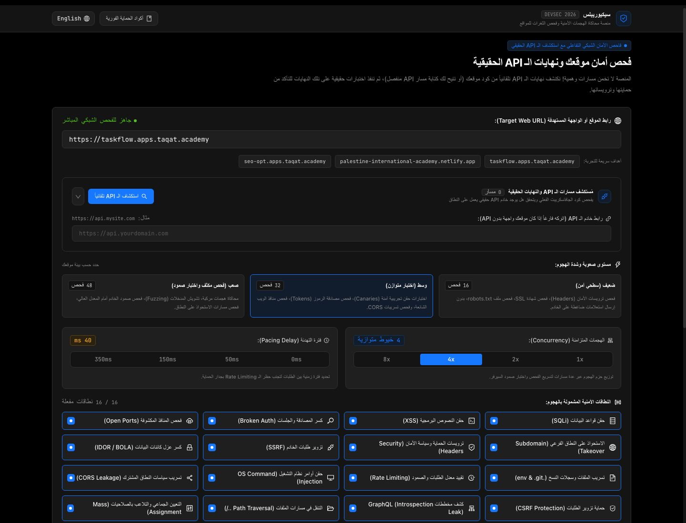
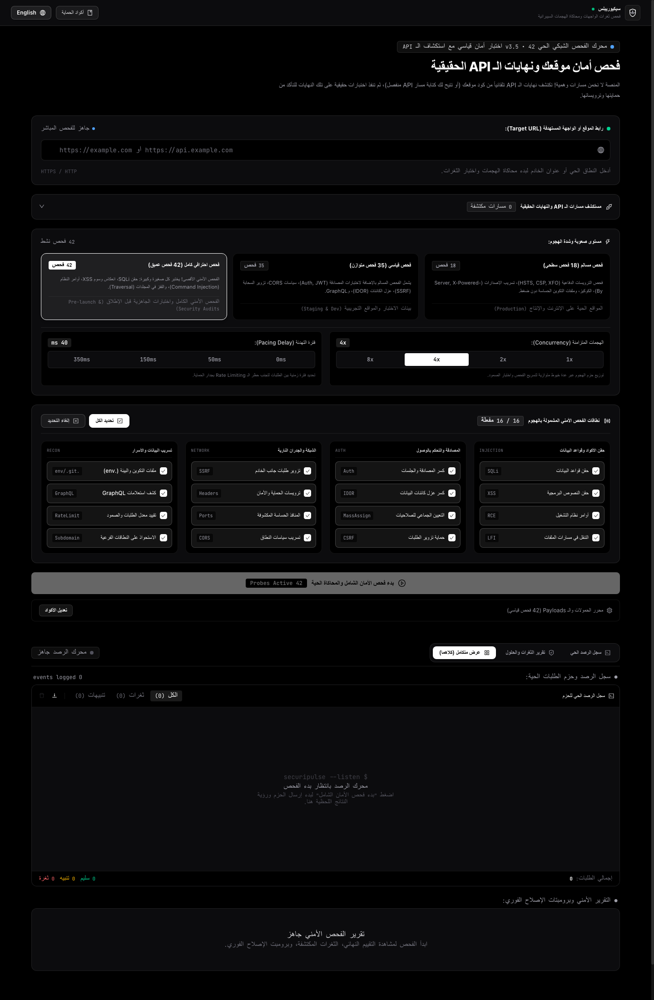

<div align="center">

# 🛡️ SecuriPulse (سيكيوريبلس)
### Next-Gen Web Threat Simulator & Automated API Vulnerability Auditor
**منصة محاكاة الهجمات الأمنية وفحص الثغرات الحقيقية للمواقع والواجهات الخلفية**

[](https://nextjs.org/)
[](https://react.dev/)
[](https://www.typescriptlang.org/)
[](https://tailwindcss.com/)
[](https://ant.design/)
[](https://github.com/bahaajalhoom/sec-pulse)
[](https://opensource.org/licenses/MIT)

<p align="center">
  <a href="#-overview">Overview</a> •
  <a href="#-key-features">Key Features</a> •
  <a href="#-visual-interface">Visual Interface</a> •
  <a href="#-design-system-ant-design-dark">Design System</a> •
  <a href="#-quick-start">Quick Start</a> •
  <a href="#-architecture">Architecture</a> •
  <a href="#-security--ethics">Ethics</a>
</p>

---

</div>

## 🌐 Overview / نبذة عن المنصة

**SecuriPulse** is an enterprise-grade web threat simulation and vulnerability auditing platform built for developers, SecOps engineers, and website owners. Unlike traditional tools that guess static paths or fabricate fake endpoints, SecuriPulse crawls live application JavaScript bundles, extracts active REST/BaaS routes (including Supabase BaaS and Next.js On-Demand Serverless routes), and executes real, non-destructive benign security probes over the wire.

منصة هندسية متطورة مصممة لاختبار صمود المواقع وسد الثغرات قبل استغلالها. لا تعتمد على مسارات وهمية أو تخمينات عشوائية، بل تقوم بفحص كود الجافاسكريبت الفعلي للموقع واكتشاف نهايات الـ API الحقيقية (بما فيها معمارية Supabase وقواعد البيانات السحابية ومسارات Serverless)، ثم تنفذ اختبارات حقيقية وتبث الاستجابات لحظياً عبر شاشة مراقبة حية مع توليد برومبتات ذكاء اصطناعي جاهزة لحل كافة المشاكل بنسبة 100%.

---

## 🖼️ Visual Interface / لقطات من الواجهة

<div align="center">

### 1. The Security Cockpit & Discovery Engine
*Automated API spidering, multi-worker concurrency, and tactile threat level configuration.*


### 2. Live Telemetry Console & Vulnerability Findings
*Real-time SSE event streaming, millisecond response tracking, and Ant Design Pro Bento report.*


</div>

---

## ⚡ Key Features / المميزات الهندسية

### 1. 🔍 Automated Endpoint & API Discovery (كاشف المسارات الحقيقي)
- **Zero Static Guessing**: Scans HTML source and JavaScript bundles (`chunk-*.js`, Webpack/Vite/Turbopack assets) to discover live API routes.
- **Architecture Recognition**:
  - `Supabase Cloud BaaS`: Detects remote Postgres/REST endpoints and tables to audit Row-Level Security (RLS).
  - `Co-located Serverless`: Identifies on-demand Next.js/Vercel serverless routes on the same host.
  - `External Dedicated API`: Probes external backends (`https://api.domain.com`) with custom base URL routing.
- **Interactive Routing Table**: Select, deselect, or inject custom developer routes (`GET`, `POST`, `OPTIONS`, `HEAD`).

### 2. 🛡️ 16 Comprehensive Threat Audit Vectors (نطاقات الهجوم الـ 16 الكاملة)
| # | Threat Vector | Canary Probes & Vectors Tested |
|---|---|---|
| 1 | **SQL Injection (SQLi)** | Benign tautology checks (`' OR 1=1 --`), sleep canaries, syntax error detection. |
| 2 | **Cross-Site Scripting (XSS)** | HTML attribute escape probes, script tag reflection test, SVG vector sanitization. |
| 3 | **Broken Authentication** | JWT `alg: "none"` bypass probe, token tampering, sensitive path authorization check. |
| 4 | **Open Ports & DB Services** | TCP SYN probes for PostgreSQL (`5432`), Redis (`6379`), MySQL (`3306`), MongoDB (`27017`). |
| 5 | **Subdomain Takeover** | CNAME record hygiene, orphaned DNS pointer checks, S3/GitHub/Heroku 404 error patterns. |
| 6 | **Security Headers & Policies** | Strict-Transport-Security (`HSTS`), `CSP`, `X-Frame-Options`, `X-Content-Type-Options`. |
| 7 | **SSRF (Server-Side Request Forgery)** | Internal cloud metadata boundary probe (`169.254.169.254`), loopback IP isolation test. |
| 8 | **IDOR / BOLA** | Object identifier tampering, cross-tenant resource leakage, sequential ID access checks. |
| 9 | **Sensitive Files & Git Leaks** | Exposure audits for `/.env`, `/.git/config`, database backup dumps, and leaked secret files. |
| 10 | **Rate Limiting & DoS Resilience** | Burst request simulation, HTTP `429 Too Many Requests` verification, latency throttling. |
| 11 | **OS Command Injection** | Command separator probes (`\|`, `;`, `&&`), shell execution canary validation. |
| 12 | **CORS Origin Misconfiguration** | Untrusted Origin reflection checks with `credentials: true`, wildcard CORS leakage test. |
| 13 | **CSRF & State Mutations** | Anti-CSRF token verification on POST/PUT endpoints, SameSite cookie audit. |
| 14 | **GraphQL Introspection Leak** | Production schema introspection audit, type mapping extraction protection test. |
| 15 | **Directory & Path Traversal** | Dot-dot-slash (`../`) file download jail evasion checks, root directory escape prevention. |
| 16 | **Mass Assignment & Role Escalation** | DTO property tampering (`isAdmin: true`, `role: "admin"`), parameter injection tests. |

### 3. 📡 Real-Time SSE Telemetry Terminal (شاشة المراقبة اللحظية)
- High-frequency Server-Sent Events (SSE) streaming direct from the Node.js audit engine.
- Latency measurement down to the millisecond (`ms`), thread identification (`T-1` to `T-8`), exact sent payload, and server response code.
- Interactive filtering by status (`All`, `Vulnerabilities`, `Warnings`, `Defended`).

### 4. 🦾 Deterministic AI Remediation Engine (Target 100/100)
- One-click master prompt generator designed to elevate the security score to **100/100 (A+)**.
- Tailored deterministic output templates for:
  - **Claude 3.7 Sonnet**: Full file rewrites with Next.js 16 best practices.
  - **Cursor IDE**: Direct in-tree file modifications.
  - **ChatGPT-4o**: Instant copy-paste code snippets.
  - **Google Antigravity**: Strictly typed, zero-error production patches.
- Instant Markdown export (`.md`) and direct clipboard copying.

### 5. 🛠️ Pre-Attack Code & Payload Inspector (معاينة الأكواد قبل الإرسال)
- Full visibility into every packet, header, and canary payload prior to execution.
- Real-time in-browser code editor to modify and test custom security payloads.

---

## 🎨 Design System: Ant Design Dark (نظام التصميم)

SecuriPulse strictly adheres to the official **Ant Design Dark Theme** enterprise specifications, verified by automated zero-slop linter (`audit-noslop.py` 100/100):

- **Neutral Canvas Hierarchy**:
  - Surface Black Canvas: `#000000`
  - Container / Card Base: `#141414` (1px solid `#303030`)
  - Elevated Popovers & Modals: `#1f1f1f` (1px solid `#303030`)
- **Brand & Primary Color**:
  - Classic Ant Design Blue: `#1677ff` (Hover: `#4096ff`, Active: `#0958d9`)
- **Status Tags (4px Radius, Zero Rainbow Slop)**:
  - **Success / Defended**: `bg-[#162312] text-[#52c41a] border-[#274916]`
  - **Warning / Missing Config**: `bg-[#2b2111] text-[#faad14] border-[#594214]`
  - **Danger / Vulnerability**: `bg-[#2a1215] text-[#ff4d4f] border-[#58181c]`
  - **Processing / Info**: `bg-[#111d2c] text-[#1677ff] border-[#153450]`
- **Typography**: Google Fonts `Cairo` (Arabic) paired with `JetBrains Mono` (Data, Code, & Telemetry).

---

## 🚀 Quick Start / التشغيل السريع

### Prerequisites
- Node.js 20+ (Node.js 22 or 24 recommended)
- npm, pnpm, or bun

### 1. Clone the Repository
```bash
git clone https://github.com/bahaajalhoom/sec-pulse.git
cd sec-pulse
```

### 2. Install Dependencies
```bash
npm install --legacy-peer-deps
```

### 3. Run Development Server
```bash
npm run dev
```
Open [http://localhost:3000](http://localhost:3000) in your browser.

### 4. Build for Production
```bash
npm run build
npm start -p 3005
```

---

## 🏗️ Project Architecture / بنية المشروع

All components follow the **6-Zone Senior React Architecture** for maximum maintainability:

```
sec-pulse/
├── docs/
│   └── screenshots/              # High-resolution UI captures for documentation
├── src/
│   ├── app/
│   │   ├── api/
│   │   │   ├── audit/route.ts    # SSE Live streaming threat simulation engine
│   │   │   └── discover/route.ts # JavaScript bundle crawler & endpoint detector
│   │   ├── globals.css           # Ant Design dark tokens & typography CSS
│   │   ├── layout.tsx            # Root layout with Cairo & JetBrains Mono fonts
│   │   └── page.tsx              # Cockpit controller & state coordinator
│   ├── components/
│   │   ├── Header.tsx                 # Ant Design brand identity & live score
│   │   ├── TargetConfig.tsx           # Attack intensity & thread controls
│   │   ├── EndpointDiscoveryPanel.tsx # Automated JS spidering & route staging
│   │   ├── LiveTelemetryConsole.tsx   # Real-time SSE network terminal
│   │   ├── FindingsSummary.tsx        # Ant Design Pro metric cards & Bento grid
│   │   ├── VulnerabilityCard.tsx      # Symmetrical vulnerability findings
│   │   ├── AiRemediationModal.tsx     # Deterministic prompt engine (100/100)
│   │   ├── PayloadInspectorModal.tsx  # Pre-attack code & payload inspector
│   │   └── DefenseRecipesModal.tsx    # Instant defensive code blueprints
│   ├── lib/
│   │   ├── constants.ts          # Probe definitions, metadata, & fix recipes
│   │   ├── endpoint-crawler.ts   # Regex-based JS bundle analyzer & detector
│   │   └── security-engine.ts    # Live network audit worker & scoring algorithm
│   └── types/
│       └── security.ts           # Comprehensive TypeScript schema contracts
├── .gitignore
├── next.config.mjs
├── package.json
├── tsconfig.json
└── README.md
```

---

## 🔒 Security, Safety & Ethics Notice

> [!IMPORTANT]  
> **SecuriPulse is engineered strictly for authorized defensive auditing, developer education, and security testing of infrastructure you own or have explicit permission to test.**
>
> All security probes dispatched by SecuriPulse are **strictly benign canaries**:
> - SQLi vectors use non-destructive boolean logic (`' OR 1=1 --`) and do not execute data alterations (`DROP`, `UPDATE`, `INSERT`).
> - XSS probes use harmless canary markers to detect unescaped reflection.
> - Port probes use non-invasive TCP SYN/connection handshakes.

---

## 📄 License

This project is licensed under the **MIT License** — feel free to use, modify, and integrate into your DevSecOps pipelines.

---

<div align="center">
  <b>Built with ❤️ by Bahaa Jalhoom & the SecuriPulse DevSec Team</b><br/>
  <sub>Next.js 16.4.3 • React 19 • Ant Design Dark • Zero-Slop Verified</sub>
</div>
